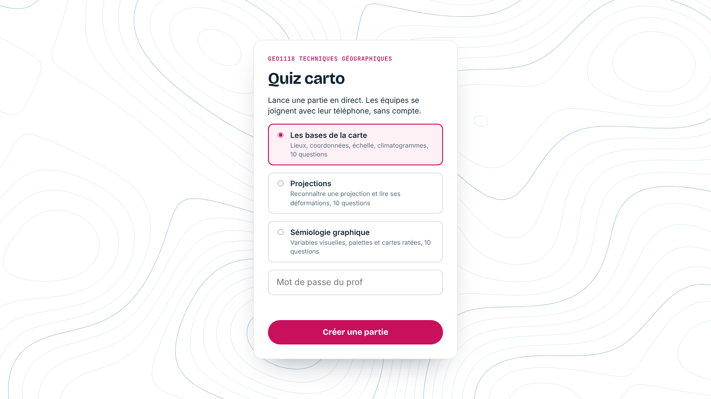
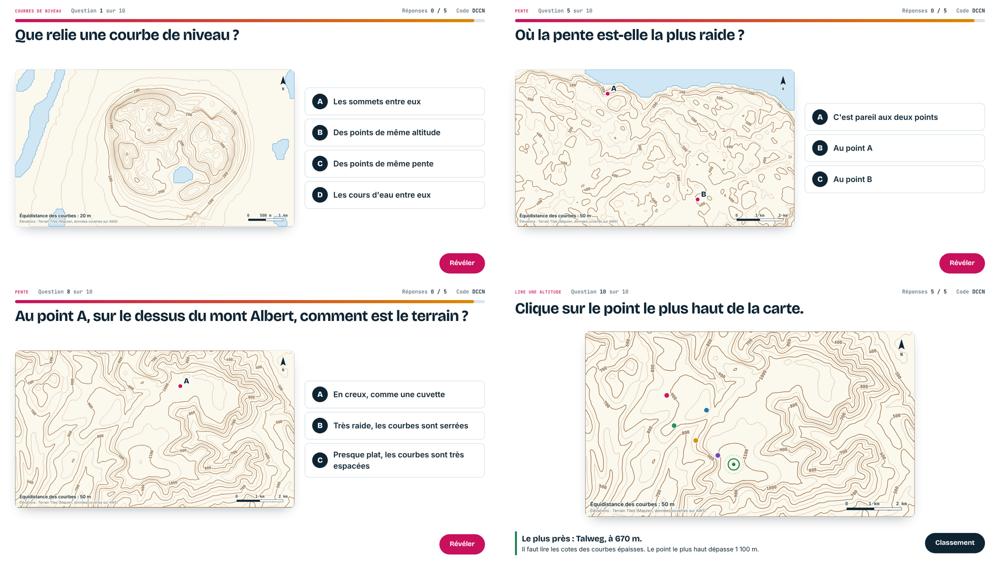
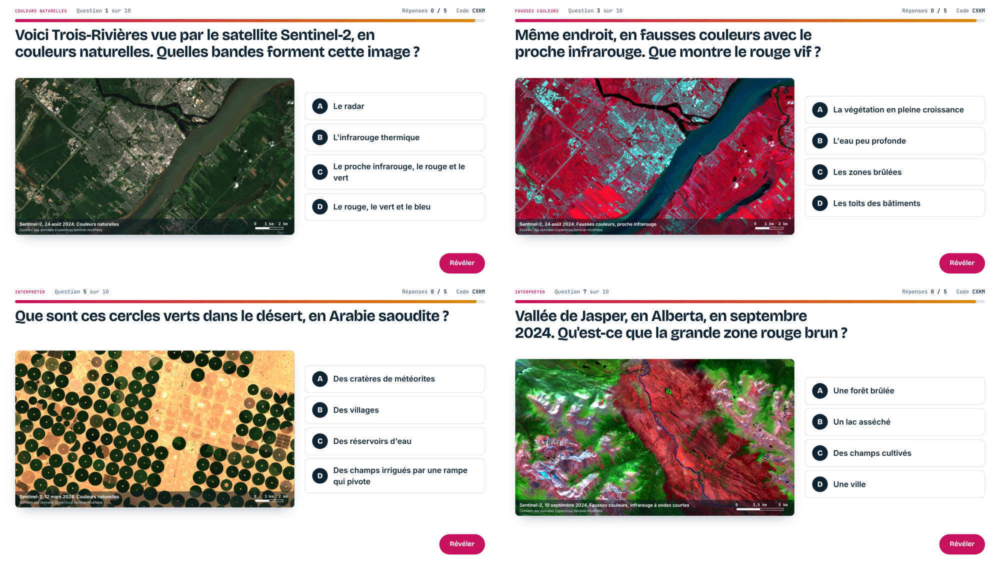
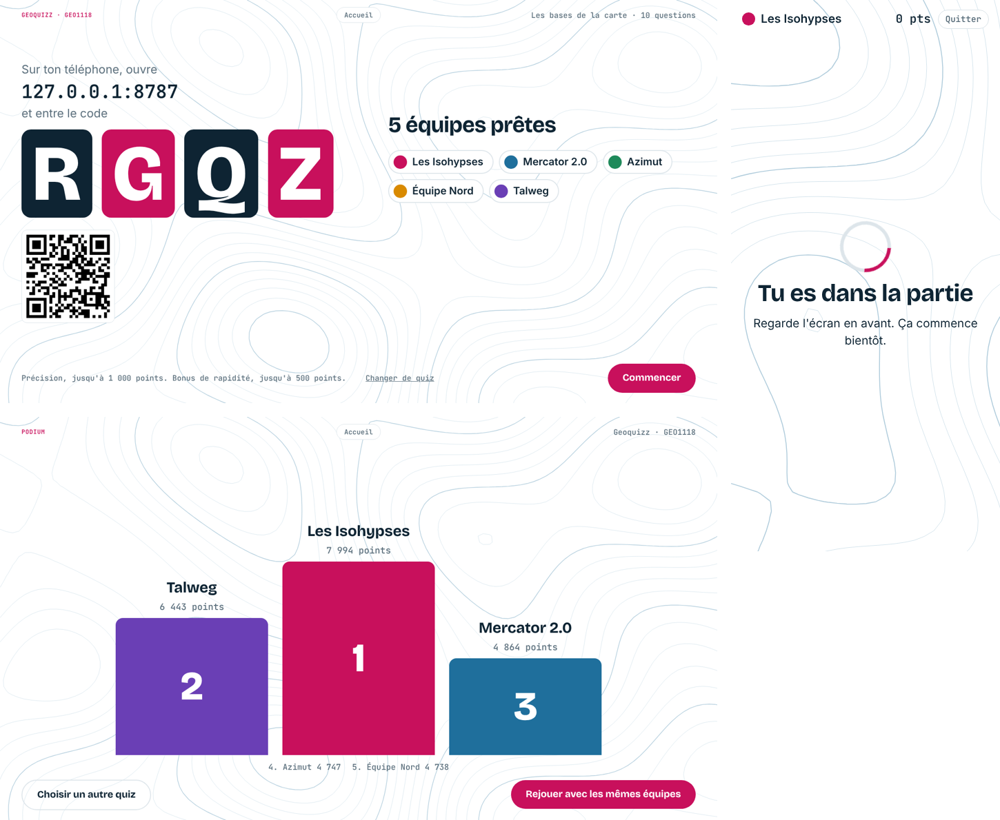
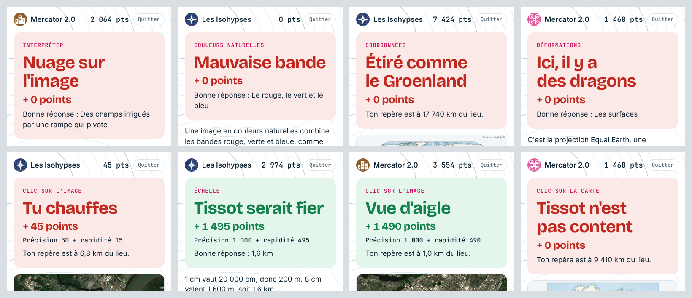

# Geoquizz

Un quiz de géographie en direct pour la classe, dans l'esprit de Kahoot, bâti pour le cours GEO1118 Techniques géographiques (UQTR, hiver 2027).

Le prof projette son écran. Les équipes se joignent avec leur téléphone, sans compte, en entrant un code de quatre lettres ou en balayant un code QR. Les questions s'appuient sur de vraies cartes et de vraies données : projections d3-geo, courbes de niveau tirées d'un modèle d'élévation, images Sentinel-2, pyramides des âges de l'ONU.



## Les sept quiz

| Quiz | Contenu |
|---|---|
| Les bases de la carte | Lieux, coordonnées, échelle, climatogrammes |
| Projections | Mercator, Equal Earth, azimutale, orthographique, indicatrices de Tissot, UTM |
| Sémiologie graphique | Variables visuelles, palettes, cartes ratées (Amérique du Sud, Banque mondiale) |
| Lire une carte topo | Courbes de niveau de vrais lieux : mont Saint-Hilaire, Saguenay, Pingualuit, mont Albert, Fuji, Grand Canyon |
| Images satellitaires | Sentinel-2 en couleurs naturelles et fausses couleurs : Trois-Rivières, Montréal, Jasper, Arabie saoudite, Aletsch |
| Graphiques mystères | Climatogrammes, pyramides des âges, graphiques ratés |
| GPS et coordonnées | Satellites, précision, formats de coordonnées, WGS 84 |

Chaque quiz a 10 questions de quatre types : choix multiple, clic sur la carte (points selon la distance), réponse chiffrée et climatogramme mystère.

Points : précision jusqu'à 1 000, plus un bonus de rapidité jusqu'à 500. Après chaque question, le téléphone affiche un message tiré au hasard dans une banque de messages de géographie (« Ici, il y a des dragons », « Tissot serait fier »).

| | |
|---|---|
|  |  |
|  |  |

## Comment ça marche

Un seul Worker Cloudflare sert les pages et garde l'état de chaque partie dans un Durable Object (WebSocket). Aucune base de données, aucun compte étudiant : seulement un nom d'équipe. Chaque partie s'efface d'elle-même 8 heures après sa création.

| Fichier | Rôle |
|---|---|
| `worker.js` | Serveur, banque de quiz (objet `QUIZZES`, tableaux `Q1` à `Q7`), normales climatiques, calcul des points |
| `host.html` | Écran du prof (`/host`) : choix du quiz, salle d'attente, questions, classement, podium |
| `play.html` | Écran des équipes (`/`) : téléphone ou ordinateur |
| `common.txt` | Code partagé, servi à `/common.js` : cartes d3-geo, cartes topo, images satellitaires, graphiques |
| `build.txt` | Préparation des cartes lourdes, servi à `/build.js` (voir plus bas) |
| `style.txt` | Feuille de style, servie à `/style.css` |

Les cartes topo et les images satellitaires sont trop lourdes pour le code. La première fois que le prof lance l'un de ces quiz, son navigateur bâtit chaque carte à partir des données ouvertes, puis l'envoie au Worker (adresse `/a/<clé>`). Les parties suivantes la relisent directement. Pour refaire une carte, changer sa clé dans `worker.js` (par exemple `topo-fuji-1` devient `topo-fuji-2`).

## Installer sa propre copie

1. Un compte Cloudflare gratuit suffit.
2. `npm install`
3. Choisir le mot de passe du prof : `npx wrangler secret put HOST_PIN`
4. `npm run deploy`

Les équipes vont à l'adresse du Worker; le prof va à `/host`.

## Ajouter un quiz ou une question

Ajouter un objet à un tableau de questions dans `worker.js`, ou écrire un nouveau tableau et l'ajouter à `QUIZZES` avec un titre et une description. Types de question :

- `qcm` : `choices`, `ans` (indice de la bonne réponse)
- `clic` : `lat`, `lon`, `tol` et `max` en km, et une carte (`proj`, `topo` ou `sat`)
- `num` : `ans`, `unit` (2 % d'écart permis)
- climatogramme : `ville` (clé de `CLIMAT`)

Chaque question a aussi `kind` (étiquette), `q` (énoncé), `dur` (secondes) et `why` (explication montrée après la question).

## Tester en local

```
echo 'HOST_PIN="test"' > .dev.vars
npm run dev
npm test          # dans un autre terminal
QZ=topo node tests/partie.js   # un quiz précis
```

Les tests jouent une partie complète avec cinq équipes simulées dans Chromium (Playwright) et enregistrent des captures dans `tests/captures/`.

`tools/applypatch.js` applique un fichier de remplacements de texte (blocs `@@ fichier`, `<<<<` ancien `====` nouveau `>>>>`). `extras/avatars.txt` garde des avatars d'équipes (16 symboles de géographie) retirés de l'app.

## Sources des données

- Fond de carte : Natural Earth, par le paquet [world-atlas](https://github.com/topojson/world-atlas)
- Élévations : [Terrain Tiles](https://registry.opendata.aws/terrain-tiles/) (Mapzen, données ouvertes sur AWS)
- Images : Copernicus Sentinel-2 L2A, fichiers publics sur AWS ([sentinel-cogs](https://registry.opendata.aws/sentinel-2-l2a-cogs/)). Contient des données Copernicus Sentinel modifiées.
- Population : Banque mondiale (population 2023, densité 2022); ONU, World Population Prospects 2019
- Normales climatiques 1991 à 2020 : ECCC, OMM, NOAA, Observatoire national d'Athènes
